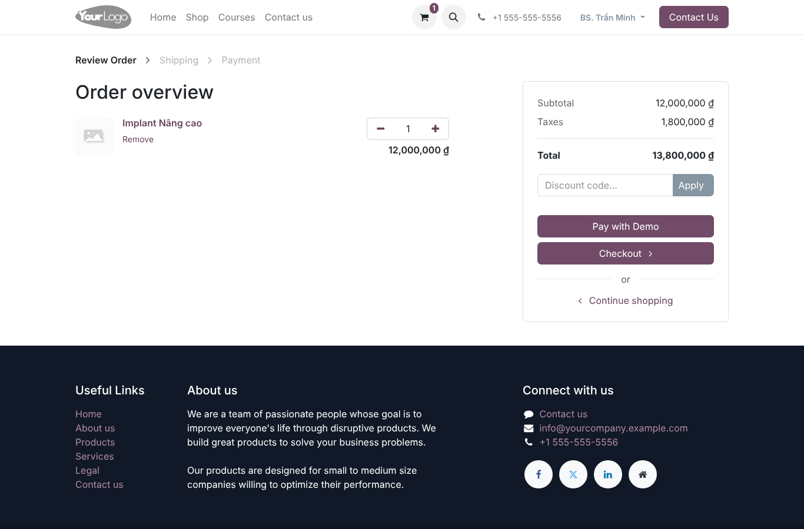
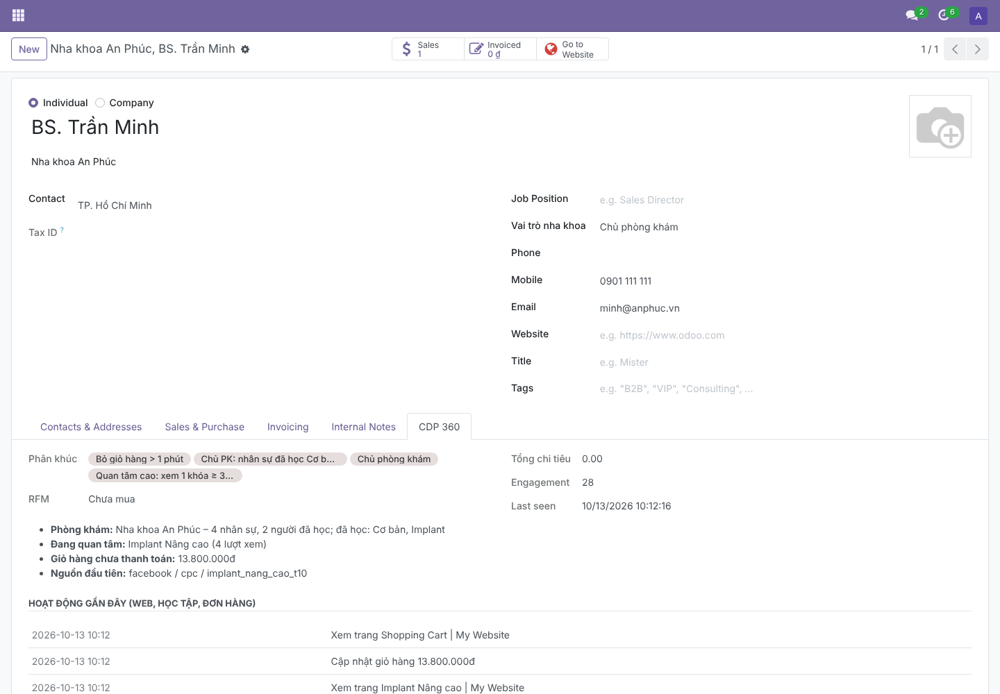
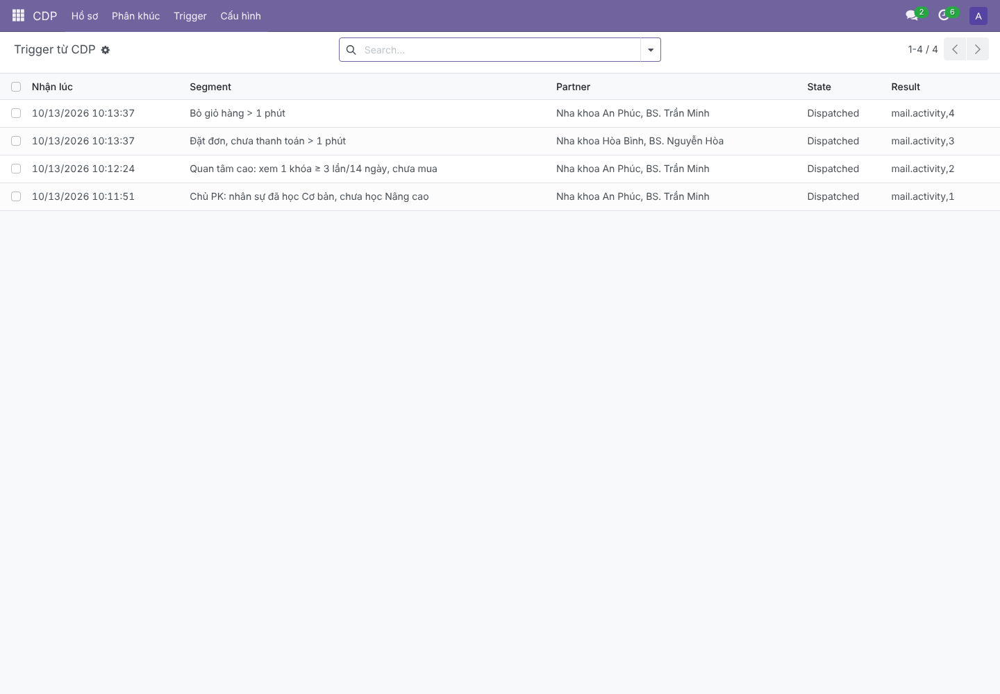
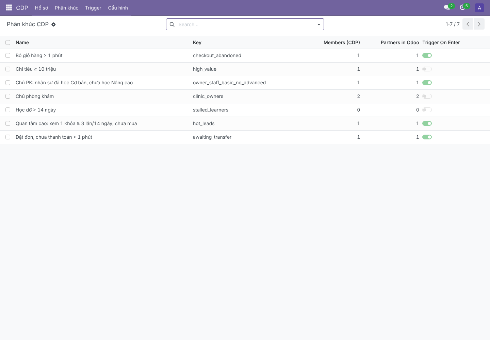
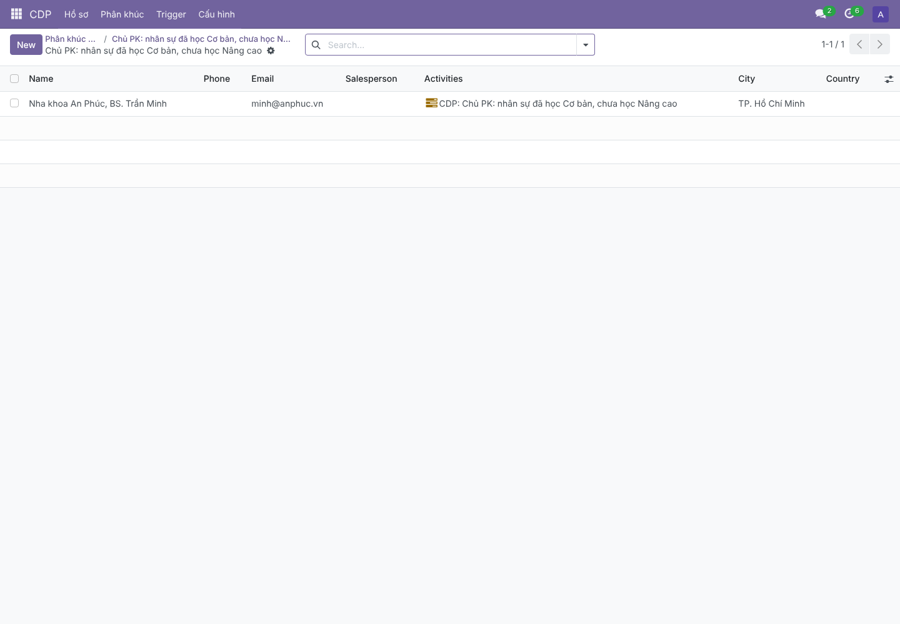
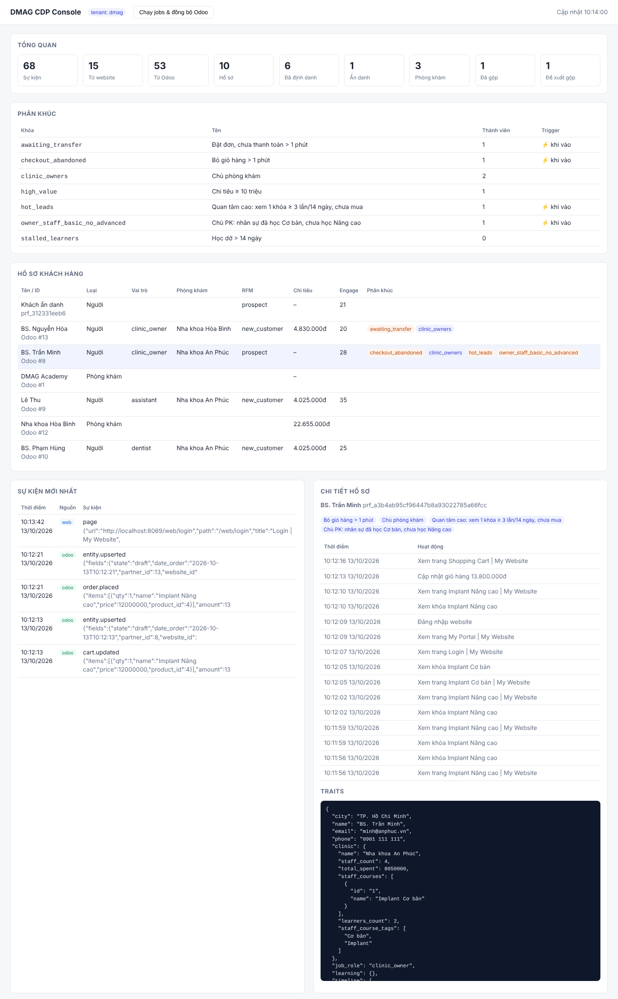

# Hướng dẫn chạy demo CDP (giai đoạn 1 – bản khung)

Demo chạy **Odoo 17 Community thật** (eLearning + website_sale) cùng các module CDP, nối với **CDP Core**. Một trình duyệt thật (Playwright) đóng vai khách hàng.

## 1. Thành phần đã dựng

| Thành phần | Thư mục | Vai trò |
|-----------|--------|--------|
| CDP Core | `core/` | FastAPI: nhận sự kiện (Odoo outbox + web SDK), hợp nhất danh tính, tính traits, phân khúc, đẩy kết quả về Odoo, console |
| `cdp_base` | `odoo_addons/cdp_base` | Outbox (gộp theo transaction, retry), mapping field, API nhận hồ sơ/phân khúc/trigger, `cdp.profile` tách khỏi `res.partner`, tab **CDP 360**, menu CDP |
| `cdp_website` | `odoo_addons/cdp_website` | Chèn SDK vào website Odoo, ký `userToken` cho người đã đăng nhập |
| `cdp_education` | `odoo_addons/cdp_education` | Sự kiện eLearning (ghi danh, tiến độ, hoàn thành), giỏ hàng, VNPay/SePay; field `dental_role` |
| Web SDK | `sdk/web/cdp.js` | page/track/identify; video YouTube + HTML5 (NAS) theo mốc 25/50/75/100%; Google Drive: mở video + thời gian học |
| Demo | `scripts/demo/` | Dữ liệu mẫu, hành trình trình duyệt, chụp màn hình |

## 2. Kịch bản demo

| Bước | Diễn ra | Kết quả mong đợi |
|-----|--------|-----------------|
| Dữ liệu mẫu | 3 khóa (Implant Cơ bản, Implant Nâng cao, Chỉnh nha Cơ bản). **Nha khoa An Phúc**: chủ BS. Trần Minh, phụ tá Lê Thu (mua Cơ bản qua VNPay, học xong), BS. Phạm Hùng (mua qua SePay, học dở), lễ tân dùng **chung SĐT với chủ**. **Nha khoa Hòa Bình**: nhân sự đã học Nâng cao | |
| Odoo → CDP | Outbox gửi 49 sự kiện | Hồ sơ người + phòng khám. Lễ tân **không** bị gộp với chủ (sinh "đề xuất gộp") |
| Phân khúc chủ PK | CDP tổng hợp theo phòng khám | BS. Trần Minh vào **"Chủ PK: nhân sự đã học Cơ bản, chưa học Nâng cao"** → trigger → Odoo tạo activity cho sales. BS. Hòa **không** vào (nhân sự đã học Nâng cao) |
| Website | Khách ẩn danh từ quảng cáo Facebook (`utm_source=facebook`) xem khóa Nâng cao 3 lần → đăng nhập → bấm *Add to Cart* | Lịch sử ẩn danh **gộp vào** hồ sơ BS. Minh, nguồn đầu tiên = facebook; vào **"Quan tâm cao"** |
| Sau 1 phút | Giỏ hàng chưa thanh toán; BS. Hòa đặt đơn chọn SePay nhưng chưa chuyển khoản | Trigger **"Bỏ giỏ hàng"** (Minh) và **"Đặt đơn, chưa thanh toán"** (Hòa) |

Ngưỡng 1 phút chỉ để demo. Thực tế cấu hình theo tenant, ví dụ 60 phút cho bỏ giỏ hàng và 30 phút cho chờ chuyển khoản.

## 3. Cách chạy

Yêu cầu:
- PostgreSQL 16;
- Python 3.12;
- mã nguồn Odoo 17.0 (`git clone --depth 1 -b 17.0 https://github.com/odoo/odoo`).

```bash
# PostgreSQL
sudo -u postgres psql -c "CREATE ROLE odoo LOGIN SUPERUSER PASSWORD 'odoo';"
sudo -u postgres psql -c "CREATE ROLE cdp LOGIN PASSWORD 'cdp';"
sudo -u postgres createdb -O cdp cdp_core

# Môi trường Python
python3.12 -m venv $RUNTIME/odoo-venv && $RUNTIME/odoo-venv/bin/pip install -r odoo17/requirements.txt
python3.12 -m venv $RUNTIME/core-venv && $RUNTIME/core-venv/bin/pip install -e "core[dev]" playwright

# odoo.conf: addons_path phải gồm .../CDP/odoo_addons; dbfilter = ^dmag$
RUNTIME=/đường/dẫn/runtime scripts/demo/run_demo.sh
```

Sau khi chạy:
- Odoo: <http://localhost:8069>
  - admin / admin;
  - tài khoản portal: minh@anphuc.vn / demo1234;
  - menu **CDP** và tab **CDP 360** trên hồ sơ khách hàng.
- CDP Console: <http://localhost:8000/console?token=demo-admin&tenant=dmag>

Kiểm thử:

```bash
cd core && pytest                    # 12 test Core (SQLite; đặt CDP_TEST_DATABASE_URL để chạy trên PostgreSQL)
odoo-bin -c odoo.conf -d cdp_test --db-filter='^cdp_test$' -i cdp_base,cdp_website,cdp_education \
         --test-enable --test-tags /cdp_base,/cdp_education --stop-after-init   # 11 test Odoo
```

## 4. Giới hạn của bản khung (để làm tiếp)

- **Xử lý đồng bộ trong request**: Core xử lý sự kiện ngay khi nhận và tính lại traits từ toàn bộ lịch sử. Đủ cho demo và vài chục nghìn hồ sơ. Giai đoạn 1 chính thức cần:
  - đưa vào hàng đợi Redpanda;
  - lưu sự kiện ở ClickHouse;
  - tính traits tăng dần (dbt).
- **Chưa có**:
  - Zalo ZNS, Facebook CAPI/Audiences;
  - consent (đồng ý xử lý dữ liệu);
  - giao diện tạo phân khúc (hiện định nghĩa bằng JSON qua API);
  - Row-Level Security đa tenant;
  - đóng gói Docker;
  - module `cdp_marketing_bridge`: cần biết cấu trúc Marketing Automation của Bizapp. Trong lúc chờ, trigger tạo **activity cho sales**.
- **Thanh toán**: demo dùng provider "VNPay (demo)" / "SePay (demo)". `cdp_education` nhận diện VNPay/SePay qua `code` hoặc tên provider. Cần mã `code` thật từ module của Bizapp.
- **`dental_role`**: field mới để demo. Nếu Bizapp đã có field vai trò nghề nghiệp thì map field đó thay thế.

## 5. Ảnh chụp từ lần chạy demo

| | |
|--|--|
| Website: giỏ hàng của BS. Minh (bỏ dở) |  |
| Odoo: tab **CDP 360** trên hồ sơ chủ phòng khám |  |
| Odoo: trigger từ CDP (tạo activity cho sales) |  |
| Odoo: danh sách phân khúc |  |
| Odoo: lọc khách hàng theo phân khúc (domain mà Marketing Automation sẽ dùng) |  |
| CDP Console |  |
